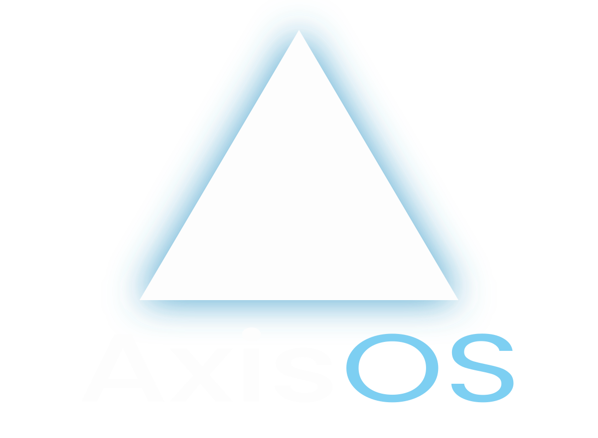

<div align="center">

  

  # AxisOS

  **A lightweight, pure C Linux desktop operating system built on Debian 12 (Bookworm) and Wayland.**

  [](LICENSE)
  [-D70A53.svg)](https://www.debian.org/)
  [-00599C.svg)](https://en.wikipedia.org/wiki/C11_(C_standard_revision))
  [](https://gitlab.freedesktop.org/wlroots/wlroots)

</div>

---

> [!NOTE]
> **Hobby Project:** AxisOS is an independent, personal hobby and educational project developed to explore Linux operating system design, pure C systems programming, Wayland compositors (`wlroots`), and custom desktop environments without large desktop suites (GNOME/KDE). It is provided as-is for experimentation and learning.

---

## Overview

AxisOS combines a minimal **Debian 12 (Bookworm)** base with a custom desktop stack written strictly in **pure C (C11)**:

* **Pure C Architecture:** 100% pure C (`-std=gnu11`) across the compositor, desktop shell, system daemons, and applications. Zero C++, Qt, or Python overhead.
* **Wayland First:** Native `wlroots` compositor with full `xdg-shell` and `wlr-layer-shell` support.
* **LiquidNodes Desktop Shell:** Custom top panel, floating dock, and application launcher powered by GTK 3 and `gtk-layer-shell`.
* **Lightweight Native Apps:** Built-in tools including `axis-terminal` (libvterm), `axis-settings`, `axis-task-manager`, and `axis-installer`.
* **Modern Linux Plumbing:** PipeWire audio, NetworkManager, systemd, and Mesa graphics acceleration.

---

## Building from Source

To compile all native pure C applications and desktop shell:

```bash
# Install build dependencies (Debian/Ubuntu)
sudo apt-get install -y build-essential gcc pkg-config libgtk-3-dev \
    libgtk-layer-shell-dev libvterm-dev libarchive-dev libjson-c-dev \
    libcurl4-openssl-dev libssl-dev libpam0g-dev libudev-dev \
    libwayland-dev libxkbcommon-dev libwlroots-dev libdrm-dev

# Compile all native applications and shell
bash os-build/scripts/compile-native-apps.sh

# Run architecture & linkage verification
bash scripts/verify-pure-c.sh
```

---

## Documentation

* [Installation Guide](INSTALLATION_GUIDE.md)
* [Installer Troubleshooting](INSTALLER_TROUBLESHOOTING.md)
* [Development Guide](DEVELOPMENT.md)

---

## License

AxisOS is open-source software licensed under the **GNU General Public License v3.0 (GPL-3.0)**. See [LICENSE](LICENSE) for details.
