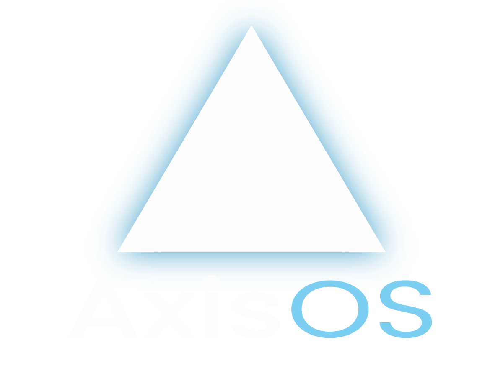

  

  
<b>A modern, high-performance Linux operating system powered by Debian 12 (Bookworm), native Wayland, and a responsive C++ / Qt 6 application suite.</b>

  

    
    
    
    
    
    
  

  

    <a href="./INSTALLATION_GUIDE.md"><b>📖 Installation Guide</b></a> •
    <a href="./DEVELOPMENT.md"><b>🛠️ Developer Guide</b></a> •
    <a href="https://github.com/jackyphuti/AxisOS/releases"><b>⬇️ Download ISO</b></a> •
    <a href="https://github.com/jackyphuti/AxisOS/issues"><b>🐛 Report Issue</b></a>
  

---

## ⚡ About AxisOS

**AxisOS** is a Debian-based Linux distribution engineered for speed, stability, and aesthetic precision. It combines the rock-solid foundation of Debian 12 Bookworm with the XanMod Linux performance kernel, a sleek GNOME Wayland desktop environment styled with the *Liquid Nodes* obsidian theme, and a suite of native C++ / Qt 6 system applications.

---

## 🖥️ System Specifications

| Component | Specification |
| :--- | :--- |
| **Base System** | Debian 12 (Bookworm) `amd64` |
| **Linux Kernel** | XanMod Realtime / Performance Linux Kernel (`linux-image-xanmod-x64v3`) |
| **Display Server** | Wayland (Native GNOME Shell session with hardware acceleration) |
| **Audio Server** | PipeWire + WirePlumber pro-audio stack |
| **Graphics & Compute** | Mesa RADV (AMD ACO), Intel Arc ANV, NVIDIA PRIME offload, Vulkan, VA-API hardware decoding |
| **Default Shell** | GNU Bash with modern interactive completions |
| **File Systems** | Btrfs (with zstd compression & automated subvolumes) and EXT4 |
| **Boot Mode** | UEFI (`x86_64-efi`) with fallback to Legacy BIOS (`isolinux`) |

---

## 🚀 Native C++ / Qt 6 Application Suite

AxisOS features zero web-wrapper / Electron overhead. All core utilities are built from scratch with native C++17/20 and Qt 6:

- **Files (`axis-files`)**: Asynchronous multi-threaded file manager with high-speed thumbnailing, MIME integration, and archive management.
- **Settings (`axis-settings`)**: Native control panel communicating with `systemd`, `NetworkManager`, `BlueZ`, and `UPower` via `QtDBus`.
- **Terminal (`axis-terminal`)**: Ultra-low-latency PTY terminal emulator powered by `libvterm` and OpenGL/SceneGraph rendering.
- **Installer (`axis-installer`)**: High-reliability graphical system installer supporting automated Btrfs/EXT4 disk partitioning, user creation, and GRUB EFI setup.
- **Software Center (`axis-software`)**: Native package manager front-end for APT and Flatpak.
- **Welcome Center (`axis-welcome`)**: Out-of-the-box system setup, driver verification, and onboarding.
- **Task Manager (`axis-tasks`)**: Process inspector and hardware resource monitor querying Linux `/proc` and `sysfs`.
- **Notes, Photos, Music, Camera**: Native Qt 6 productivity and multimedia tools.

---

## 🔗 Quick Links & Documentation

- **[Installation Guide](INSTALLATION_GUIDE.md)** — Step-by-step flashing, BIOS/UEFI setup, and drive partitioning guide.
- **[Developer & Build Guide](DEVELOPMENT.md)** — Compiling native C++ applications, chroot setup, and generating bootable ISOs.
- **[Releases & ISO Downloads](https://github.com/jackyphuti/AxisOS/releases)** — Download the latest bootable live ISO (`axisos-v2.0-live-amd64.iso`).
- **[Issue Tracker](https://github.com/jackyphuti/AxisOS/issues)** — Bug reports, feature requests, and system discussions.

---

## 📄 License

AxisOS is free and open-source software licensed under the **GNU General Public License v3.0 (GPL-3.0)**. See the [LICENSE](LICENSE) file for details.
