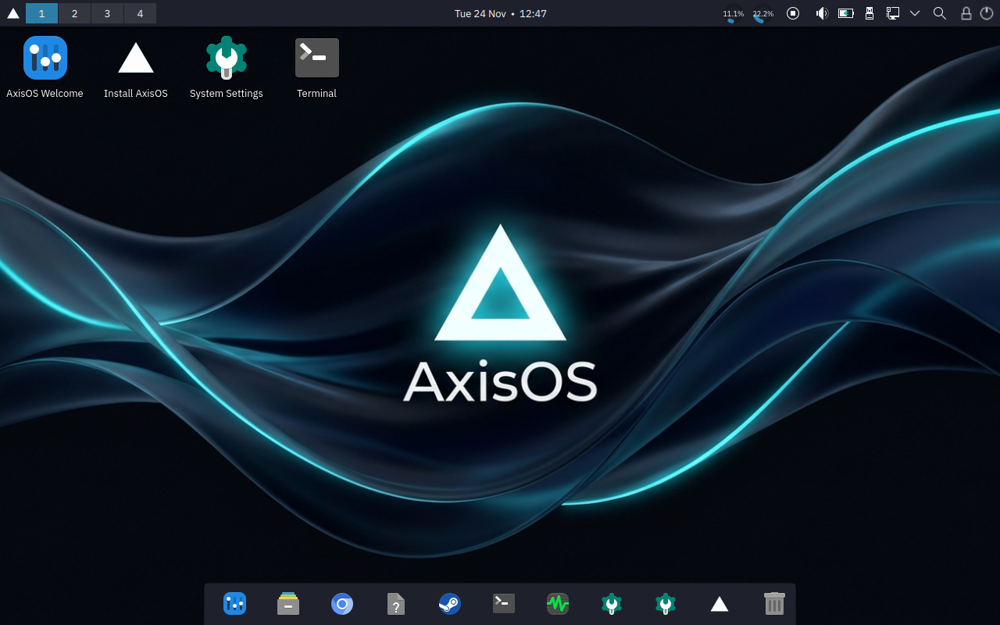
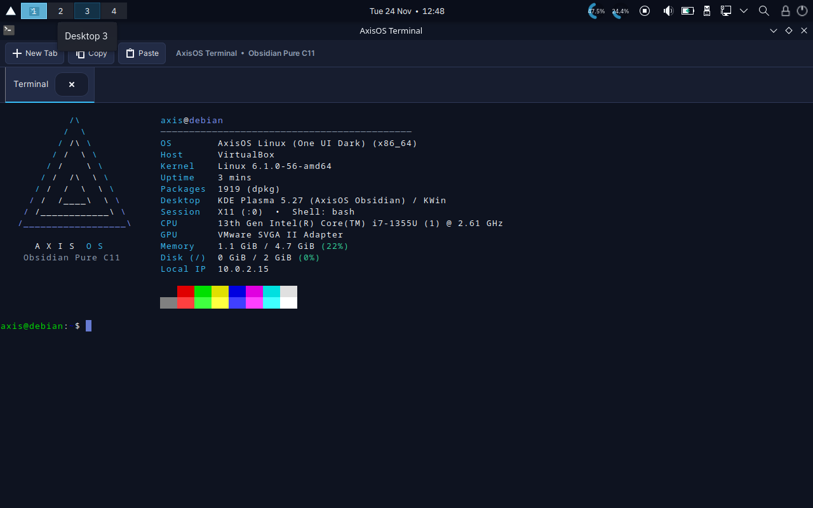
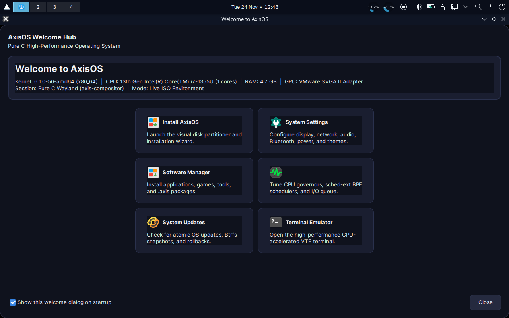
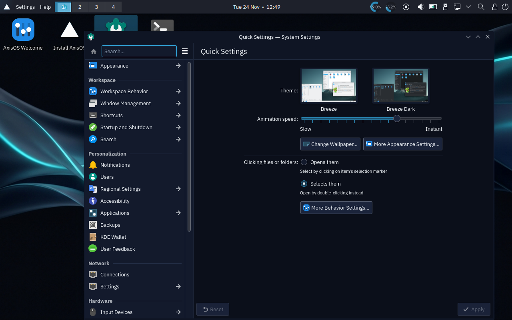
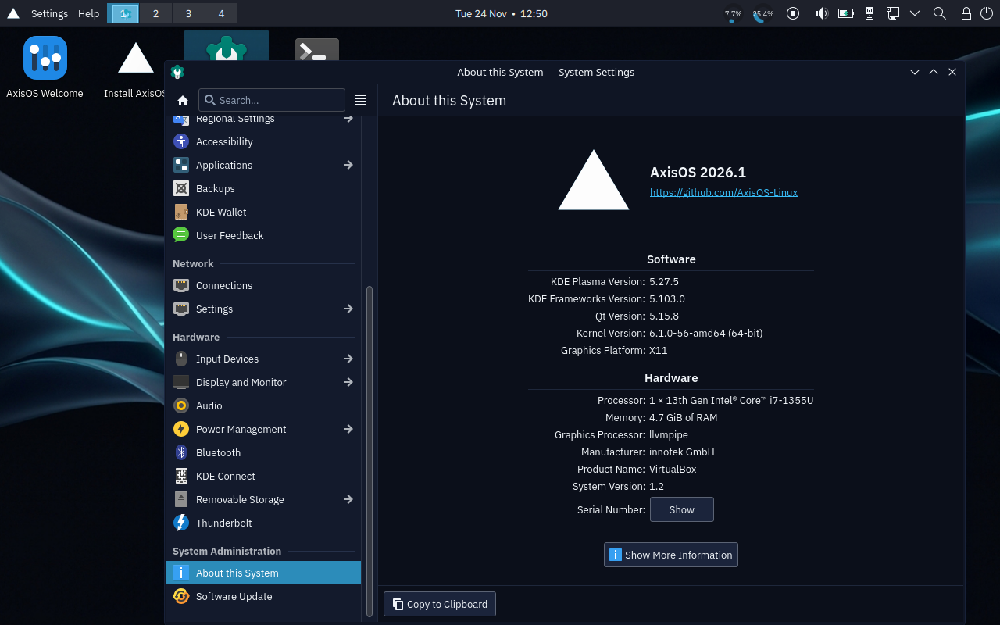
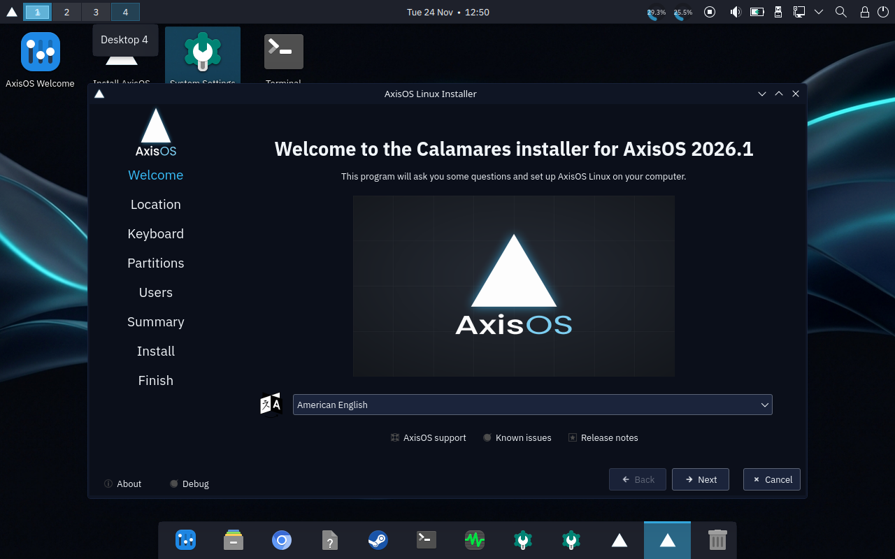

<div align="center">

  

  # AxisOS

  **A fast, Debian 12 (Bookworm) Linux desktop OS with a custom AxisOS Obsidian KDE Plasma layout and a 100% Pure C11 native app suite.**

  [](LICENSE)
  [-D70A53.svg)](https://www.debian.org/)
  [](https://kde.org/plasma-desktop/)
  [](https://en.wikipedia.org/wiki/C11_(C_standard_revision))
  [](https://github.com/jackyphuti/AxisOS/releases/tag/v1.0.0)

</div>

---

## Screenshots

<p align="center">
  
  <br />
  <em><b>AxisOS Obsidian Desktop</b> — Floating top Command HUD with live CPU/RAM gauges and centered floating glass dock</em>
</p>

<table>
  <tr>
    <td align="center" width="50%">
      
      <br />
      <b>AxisOS Terminal &amp; Fetch (Pure C11 / libvterm)</b>
    </td>
    <td align="center" width="50%">
      
      <br />
      <b>AxisOS Welcome Hub (Pure C11 / GTK 3)</b>
    </td>
  </tr>
  <tr>
    <td align="center" width="50%">
      
      <br />
      <b>System Settings (AxisOS Obsidian Dark Theme)</b>
    </td>
    <td align="center" width="50%">
      
      <br />
      <b>About AxisOS 2026.1</b>
    </td>
  </tr>
  <tr>
    <td align="center" colspan="2">
      
      <br />
      <b>Branded Offline Calamares Installer (UEFI + Legacy BIOS + LUKS)</b>
    </td>
  </tr>
</table>

---

> [!NOTE]
> **Hobby & Independent Project:** AxisOS is an independent personal and educational Linux distribution project combining Debian 12 Bookworm stability with custom Pure C11 native desktop tools (`-O3` LTO), gaming/developer out-of-the-box readiness, and bi-monthly OTA updates.

---

## Overview

AxisOS pairs a rock-solid **Debian 12 (Bookworm)** foundation with a custom **AxisOS Obsidian** KDE Plasma 5.27 desktop and a native system utility suite written strictly in **Pure C11 (`-std=gnu11`)**:

* **100% Pure C11 Native App Suite (`-O3` LTO):** Zero Python, C++, or Electron overhead across AxisOS system utilities — including `axis-terminal` (libvterm with full Copy/Paste), `axis-task-manager` (Windows 11 dark style with Cairo 3D icons), `axis-hardware-manager` (GPU drivers, codecs & gaming hub), `axis-software-manager` & `axis-package-installer` (unified Flathub + APT), `axis-scheduler-manager`, `axis-welcome`, and `axis-fetch`.
* **Ready Out of the Box:** Pre-installed with **Visual Studio Code**, **Steam** (with 32-bit `i386` Mesa/Vulkan), **Flathub (Flatpak)**, `non-free-firmware`, multimedia codecs, GameMode, MangoHud, and Gamescope — with **zero Snaps**.
* **Performance-Tuned Kernel & Desktop:** Ships with `zstd` ZRAM compressed RAM swap, TCP BBR congestion control, NVMe/SSD/HDD I/O scheduler tuning, `schedutil`/`performance` CPU governor, snappy low-latency KWin animations, and Baloo background indexing disabled.
* **Install-Once Bi-Monthly OTA Updates:** Built-in systemd OTA updater (`sudo axisos-update`) keeps native Pure C apps, desktop configs, and Debian security patches up to date without reinstalling.

---

## Download & Install

1. Download the latest bootable hybrid ISO (UEFI & Legacy BIOS) from [**GitHub Releases (v1.0.0)**](https://github.com/jackyphuti/AxisOS/releases/tag/v1.0.0).
2. Flash `axisos-live-amd64.iso` to a USB drive using Ventoy, Rufus, or BalenaEtcher and boot into AxisOS Live.
3. Launch **Install AxisOS** (Calamares) to install offline.
4. Keep your installed system updated anytime via Terminal:

```bash
sudo axisos-update
```

---

## Building from Source

To compile all native Pure C11 applications and desktop shell:

```bash
# Install build dependencies (Debian/Ubuntu)
sudo apt-get install -y build-essential gcc pkg-config libgtk-3-dev \
    libgtk-layer-shell-dev libvterm-dev libarchive-dev libjson-c-dev \
    libcurl4-openssl-dev libssl-dev libpam0g-dev libudev-dev \
    libwayland-dev libxkbcommon-dev libwlroots-dev libdrm-dev

# Compile all native applications and shell (-O3 LTO)
bash os-build/scripts/compile-native-apps.sh

# Run architecture & strict Pure C linkage verification
bash scripts/verify-pure-c.sh
```

---

## Documentation

* [Installation Guide](INSTALLATION_GUIDE.md)
* [Installer Troubleshooting](INSTALLER_TROUBLESHOOTING.md)
* [Development Guide](DEVELOPMENT.md)

---

## License

AxisOS is open-source software licensed under the **GNU General Public License v3.0 (GPL-3.0)**. See [LICENSE](LICENSE) for details.
